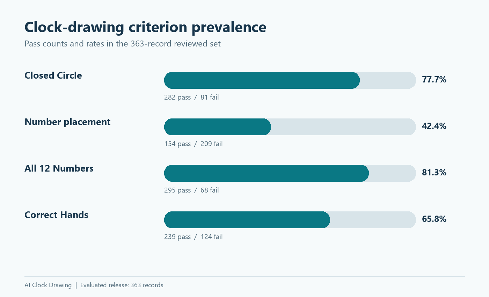
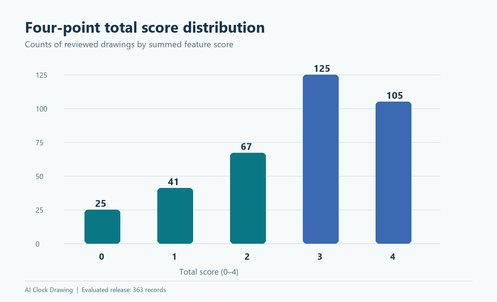
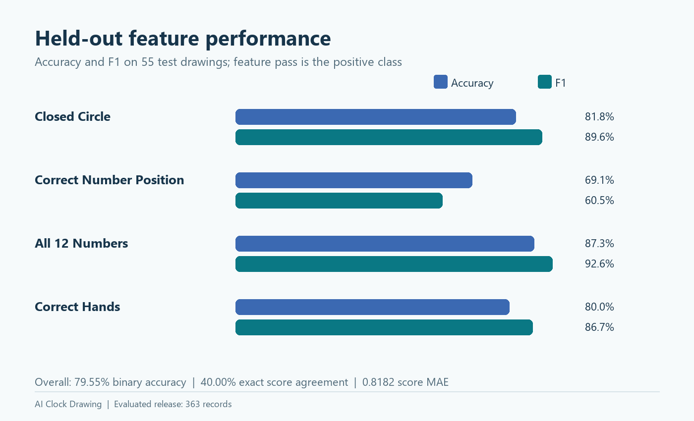
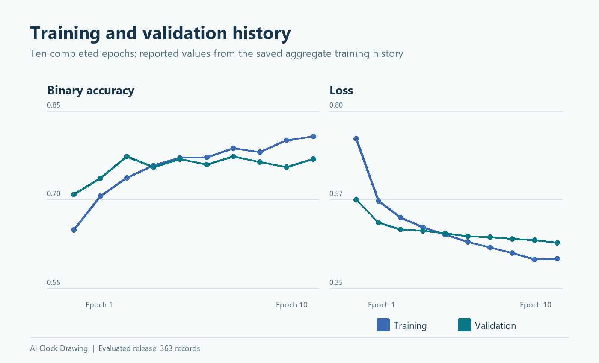

# Results and charts

These aggregate-only outputs describe the completed educational ResNet50 baseline. The 55-record held-out test partition reports **79.55% binary feature accuracy**, **40.00% exact total-score agreement**, and **0.8182 score MAE**. These measures are not diagnostic accuracy.

## Charts

| Chart | What it shows |
| --- | --- |
| [Criterion pass rates](criterion_pass_rates.png) | Aggregate pass/fail counts across 363 reviewed records |
| [Total score distribution](total_score_distribution.png) | Reviewed-record counts at scores 0–4 |
| [Held-out performance](held_out_performance.png) | Feature-level accuracy and F1 on 55 test records |
| [Training history](training_history.png) | Training and validation accuracy/loss across ten epochs |

## Aggregate source tables

| Table | Contents |
| --- | --- |
| [baseline_metrics.csv](baseline_metrics.csv) | Four feature-level held-out test metric rows |
| [criteria_distribution.csv](criteria_distribution.csv) | Four criterion-level pass/fail totals |
| [total_score_distribution.csv](total_score_distribution.csv) | Five reviewed-record score-count totals |
| [training_history.csv](training_history.csv) | Ten epoch-level training/validation summaries |

The four PNG charts were generated from the included aggregate CSV summaries and contain no clock drawings. Per-image predictions, split manifests, validation records, and image hashes remain outside GitHub. See the [Evaluation Report](../docs/Evaluation_Report.md) for interpretation and limitations.
